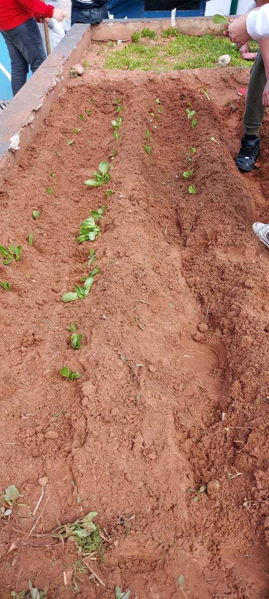

  

## Situation

I led a high school initiative aimed at encouraging students to adopt concrete ecological actions in order to obtain the E3D label, which stands for “École en démarche de développement durable” (school committed to sustainable development). The objective was to transform environmental awareness into practical commitments across the school community.

In this context, sustainability was not treated as a theoretical concept, but as a daily responsibility. Students were encouraged to reflect on how their behaviors, habits, and collective decisions could reduce the school’s environmental footprint while also promoting civic engagement and responsibility.

## Tasks

My role was to mobilize students, coordinate actions, and help the school build a structured approach around sustainability. This included raising awareness, identifying priority areas, and guiding the community toward concrete measures that could be evaluated as part of the E3D certification process.

The challenge was to move from awareness to action by creating a motivating and inclusive framework in which students could participate actively and see the impact of their efforts.

## Actions

I worked with students to identify ecological actions that were realistic, measurable, and aligned with the school environment. These included waste reduction, better sorting practices, energy-saving initiatives, environmental education activities, and projects encouraging reflection on responsible consumption and sustainable habits.

I also helped create a collective dynamic through communication, student involvement, and regular follow-up. By making sustainability visible and participatory, we were able to turn environmental goals into concrete commitments that students could take ownership of.

## Results

This initiative helped students understand that sustainability is not only about large-scale policies or abstract ideals; it is also about everyday decisions and collective behavior. By engaging in practical actions, they gained a greater sense of responsibility and a stronger connection to environmental issues.

The project strengthened my ability to lead a school-based initiative, promote collaboration, and turn values into concrete results. It also showed me that education plays a central role in building long-term ecological awareness, especially when students are encouraged to become active actors in the transition toward a more sustainable society.
