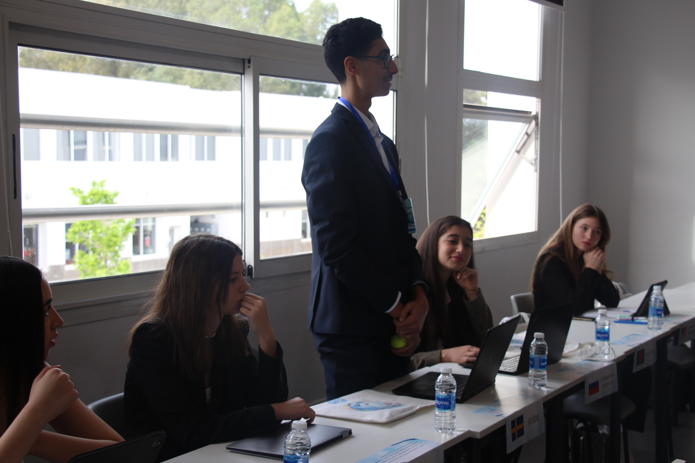
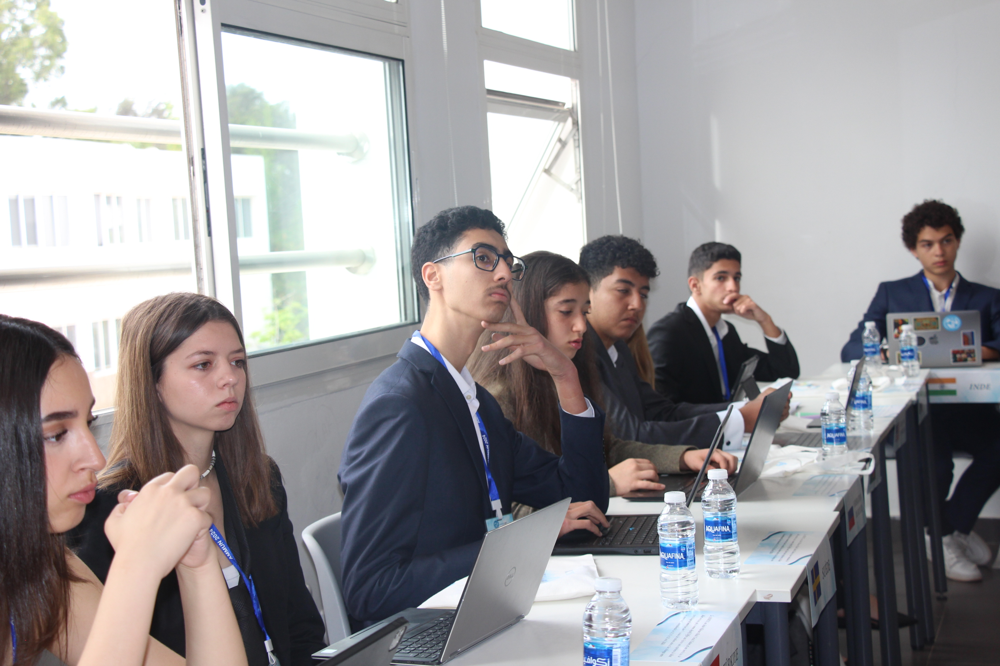

## Situation

During a three-day Model United Nations simulation at Lycée André Malraux, I represented the Swedish delegation under the theme “Uniting for Sustainable Solutions.” The central issue we discussed was the social implications of artificial intelligence and automation in industry. In this international diplomatic setting, each delegation had to negotiate, defend its position, and propose realistic solutions that balanced technological progress with social responsibility. As the representative of Sweden, I had to approach the topic from a sustainability-focused perspective, emphasizing that innovation should not come at the expense of workers’ dignity, equality, or long-term societal resilience.

## Tasks

My main responsibility was to analyze how artificial intelligence and automation would affect employment, labor rights, social inclusion, and economic stability across different industries. I also had to participate in negotiations with other delegations, defend Sweden’s position, and contribute to the creation of a policy proposal that reflected both technological advancement and sustainable development. In addition, I needed to communicate clearly and persuasively in a highly dynamic environment, where decisions had to be made collaboratively under time pressure.

## Actions

To prepare, I researched the social consequences of automation, including job displacement, the digital divide, the need for retraining programs, and the importance of protecting vulnerable workers. I then worked closely with my delegation to develop arguments grounded in fairness, long-term economic stability, and responsible innovation. During the debates, I actively engaged in discussions, listened to multiple perspectives, and advocated for solutions that combined technological development with social protection. I also contributed to drafting a collective resolution focused on sustainable industrial transformation, worker-centered policies, and international cooperation in the face of shared challenges.

## Results

This experience strengthened my ability to think critically about the relationship between technology and society. It deepened my understanding of how innovation can be aligned with sustainability and social equity, especially in contexts where economic growth and human well-being must coexist. Through negotiation and public speaking, I improved my communication, diplomacy, and problem-solving skills while learning how to construct practical solutions in a complex global environment. The simulation also reinforced my interest in addressing major societal challenges through collaborative and forward-thinking approaches. Overall, it was a meaningful opportunity to connect technological progress with human-centered and sustainable solutions, a perspective that continues to shape my academic and professional ambitions.
